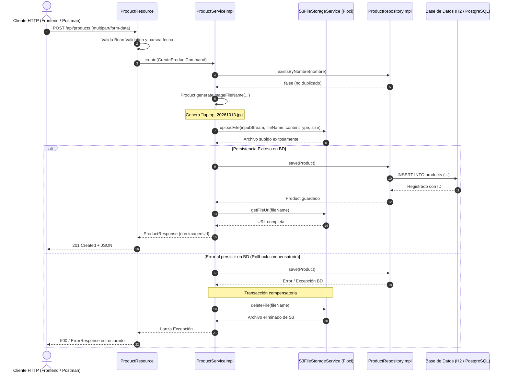
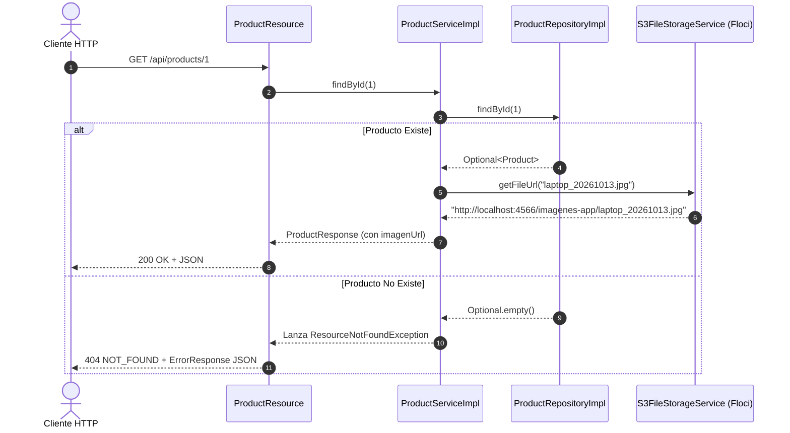

# Product Service — Quarkus & Clean Architecture

Microservicio/módulo backend empresarial para la gestión de productos con almacenamiento de imágenes en **Amazon S3 / Floci**, desarrollado con **Java 21**, **Quarkus 3.40.1**, **Clean Architecture** (Arquitectura Limpia) y el patrón **Modular Monolith**.

---

## Tabla de Contenidos

- [1. Descripción General](#1-descripción-general)
- [2. Stack Tecnológico](#2-stack-tecnológico)
- [3. Arquitectura del Sistema](#3-arquitectura-del-sistema)
  - [3.1. Principios de Clean Architecture](#31-principios-de-clean-architecture)
  - [3.2. Regla de Dependencias](#32-regla-de-dependencias)
  - [3.3. Estructura Global de Directorios](#33-estructura-global-de-directorios)
- [4. Documentación Detallada por Package](#4-documentación-detallada-por-package)
  - [4.1. Módulo Product — Domain](#41-módulo-product--domain)
    - [4.1.1. `com.example.application.product.domain.model`](#411-comexampleapplicationproductdomainmodel)
    - [4.1.2. `com.example.application.product.domain.repository`](#412-comexampleapplicationproductdomainrepository)
  - [4.2. Módulo Product — Application](#42-módulo-product--application)
    - [4.2.1. `com.example.application.product.application.dto`](#421-comexampleapplicationproductapplicationdto)
    - [4.2.2. `com.example.application.product.application.service`](#422-comexampleapplicationproductapplicationservice)
  - [4.3. Módulo Product — Infrastructure](#43-módulo-product--infrastructure)
    - [4.3.1. `com.example.application.product.infrastructure.resource`](#431-comexampleapplicationproductinfrastructureresource)
    - [4.3.2. `com.example.application.product.infrastructure.mapper`](#432-comexampleapplicationproductinfrastructuremapper)
    - [4.3.3. `com.example.application.product.infrastructure.persistence`](#433-comexampleapplicationproductinfrastructurepersistence)
  - [4.4. Módulo Shared — Cross-Cutting Concerns](#44-módulo-shared--cross-cutting-concerns)
    - [4.4.1. `com.example.application.shared.storage`](#441-comexampleapplicationsharedstorage)
    - [4.4.2. `com.example.application.shared.exception`](#442-comexampleapplicationsharedexception)
    - [4.4.3. `com.example.application.shared.config`](#443-comexampleapplicationsharedconfig)
  - [4.5. Paquetes de Pruebas (Tests)](#45-paquetes-de-pruebas-tests)
- [5. Flujos de Ejecución y Diagramas](#5-flujos-de-ejecución-y-diagramas)
  - [5.1. Flujo de Creación de Producto (Multipart + S3 + Rollback)](#51-flujo-de-creación-de-producto-multipart--s3--rollback)
  - [5.2. Flujo de Consulta por ID y Listado](#52-flujo-de-consulta-por-id-y-listado)
- [6. Especificación de Endpoints REST](#6-especificación-de-endpoints-rest)
- [7. Regla de Negocio: Nomenclatura de Imágenes](#7-regla-de-negocio-nomenclatura-de-imágenes)
- [8. Configuración del Entorno y Floci S3](#8-configuración-del-entorno-y-floci-s3)
- [9. Guía de Ejecución y Pruebas](#9-guía-de-ejecución-y-pruebas)

---

## 1. Descripción General

`product-service` es un servicio desacoplado y de alto rendimiento encargado de la administración del catálogo de productos. Permite registrar nuevos productos recibiendo sus datos y archivo multimedia en una sola petición `multipart/form-data`, persistiendo la metadata en base de datos y cargando automáticamente la imagen a un bucket S3 (emulado localmente con **Floci** o cualquier proveedor compatible con AWS S3).

El proyecto fue construido bajo los principios de **Clean Architecture**, **SOLID**, **Domain-Driven Design (DDD)** y **código limpio**, garantizando:
- Independencia total del núcleo de negocio frente a frameworks y librerías externas.
- Alta testabilidad con mocks en capas de servicio y recursos.
- Preparación para evolucionar de un monolito modular a un microservicio autónomo sin reescribir la lógica de dominio.

---

## 2. Stack Tecnológico

| Tecnología / Herramienta | Versión | Rol / Propósito |
| :--- | :--- | :--- |
| **Java** | `21 (LTS)` | Lenguaje de programación principal (Records, Pattern Matching, Switch Expressions). |
| **Quarkus** | `3.40.1` | Framework Cloud-Native supersónico y subatómico (Modo imperativo). |
| **Hibernate ORM / Panache** | Incluido en BOM | Capa de persistencia relacional y patrón Repository sin `@Query`. |
| **H2 Database** | En memoria | Base de datos relacional para pruebas y desarrollo rápido (migrable a PostgreSQL). |
| **AWS SDK v2 (S3)** | `2.31.54` | Cliente oficial de AWS para interactuar con buckets S3 de forma síncrona (`UrlConnectionHttpClient`). |
| **Floci / LocalStack** | `2.2.0` | Emulador local compatible con la API de AWS S3 para desarrollo y testing sin costo en la nube. |
| **Jakarta Bean Validation** | `3.0` | Validación declarativa de datos de entrada en el borde de la aplicación (`@NotBlank`, `@Positive`, etc.). |
| **MapStruct** | `1.6.3` | Mapeo automático de modelos, entidades JPA y DTOs en tiempo de compilación (CDI). |
| **Lombok** | `1.18.36` | Reducción de boilerplate (`@Getter`, `@Setter`, `@Builder`, `@RequiredArgsConstructor`). |
| **SmallRye OpenAPI / Swagger** | Incluido en BOM | Documentación viva de la API REST e interfaz interactiva Swagger UI. |
| **JUnit 5 / Mockito / RestAssured** | Incluido en BOM | Pruebas unitarias, mocks CDI con `@InjectMock` y pruebas de integración HTTP. |
| **Maven** | `3.9+` | Gestión de dependencias y ciclo de vida de construcción. |

---

## 3. Arquitectura del Sistema

### 3.1. Principios de Clean Architecture

La aplicación organiza el código en círculos concéntricos donde **el dominio reside en el centro**, completamente aislado:

```text
               ┌─────────────────────────────────────────┐
               │              INFRASTRUCTURE             │
               │  REST Resources | JPA/Panache | S3 AWS  │
               │   ┌─────────────────────────────────┐   │
               │   │           APPLICATION           │   │
               │   │      Use Cases | DTOs (Records) │   │
               │   │   ┌─────────────────────────┐   │   │
               │   │   │         DOMAIN          │   │   │
               │   │   │  Entities | Rules | Repos│  │   │
               │   │   └─────────────────────────┘   │   │
               │   └─────────────────────────────────┘   │
               └─────────────────────────────────────────┘
```

1. **Domain (Núcleo)**: Modela el negocio sin dependencias de frameworks ni infraestructura (sin JPA, sin HTTP, sin AWS).
2. **Application (Casos de Uso)**: Orquesta la lógica del negocio mediante interfaces de servicio y transfiere datos puros vía DTOs inmutables (`record`).
3. **Infrastructure (Adaptadores Externos)**: Contiene los detalles técnicos (endpoints REST, base de datos con Panache, clientes HTTP/S3, mappers MapStruct).

### 3.2. Regla de Dependencias

- **Infrastructure** conoce a **Application** y a **Domain**.
- **Application** conoce a **Domain**, pero **nunca** a Infrastructure.
- **Domain** no conoce a nadie.
- Los casos de uso interactúan con la infraestructura únicamente a través de **inversión de dependencias (DIP)** mediante interfaces (`ProductRepository`, `FileStorageService`).

### 3.3. Estructura Global de Directorios

```text
src/main/java/com/example/application/
├── product/                         # Módulo de Dominio: PRODUCT
│   ├── domain/                      # Capa de Dominio (Pura)
│   │   ├── model/                   # Entidades de dominio y reglas
│   │   └── repository/              # Contratos/interfaces de persistencia
│   ├── application/                 # Capa de Casos de Uso
│   │   ├── dto/                     # Data Transfer Objects (Records)
│   │   └── service/                 # Servicios de aplicación (Interface + Impl)
│   └── infrastructure/              # Capa de Infraestructura (Adaptadores)
│       ├── mapper/                  # Mappers MapStruct (CDI)
│       ├── persistence/             # Entidades JPA y Repositorios Panache
│       └── resource/                # Endpoints REST y Forms Multipart
│
└── shared/                          # Componentes Transversales Reutilizables
    ├── config/                      # Configuraciones CDI
    ├── exception/                   # Excepciones de negocio y Handler Global
    └── storage/                     # Abstracción y Adaptador S3 (AWS SDK v2)
```

---

## 4. Documentación Detallada por Package

A continuación se detalla cada paquete del proyecto, su responsabilidad, sus componentes y el rol que desempeñan.

---

### 4.1. Módulo Product — Domain

El paquete `domain` define el corazón del negocio del catálogo de productos. No tiene dependencias de librerías externas de persistencia ni de transporte.

#### 4.1.1. `com.example.application.product.domain.model`

Contiene las entidades del dominio y la lógica intrínseca a ellas.

##### `Product.java`
- **Tipo**: Clase Java POJO anotada con Lombok (`@Getter`, `@Setter`, `@Builder`, `@NoArgsConstructor`, `@AllArgsConstructor`).
- **Responsabilidad**: Representar un producto dentro del modelo de dominio con sus atributos esenciales:
  - `idProduct` (`Long`): Identificador único del producto.
  - `nombre` (`String`): Nombre comercial o descriptivo.
  - `descripcion` (`String`): Detalle técnico o comercial.
  - `cantidad` (`Integer`): Stock disponible en inventario.
  - `monto` (`BigDecimal`): Precio unitario monetario.
  - `fechaIngreso` (`LocalDate`): Fecha de registro en el sistema.
  - `imagen` (`String`): Nombre único del archivo de imagen asignado en el bucket S3.
- **Regla de Negocio Incrustada (`generateImageFileName`)**:
  Método estático de dominio que genera el nombre estandarizado del archivo de imagen a partir del nombre del producto, la fecha de ingreso y el archivo original recibido.
  ```text
  nombre_limpio + "_" + fechaIngreso(yyyyMMdd) + extension
  Ejemplo: "Laptop Gamer Pro" + 2026-10-13 -> "laptop_gamer_pro_20261013.jpg"
  ```
  - Sanitiza espacios sustituyéndolos por guiones bajos `_`.
  - Remueve caracteres especiales conservando únicamente alfanuméricos, guiones y guiones bajos.
  - Conserva la extensión original (`.jpg`, `.jpeg`, `.png`, etc.) o asigna `.jpg` por defecto.

#### 4.1.2. `com.example.application.product.domain.repository`

Define los contratos de acceso a datos requeridos por el dominio, aplicando el Principio de Inversión de Dependencias (DIP).

##### `ProductRepository.java`
- **Tipo**: Interfaz Java pura.
- **Responsabilidad**: Definir las operaciones de persistencia que el dominio necesita:
  - `Product save(Product product)`: Guarda o actualiza un producto de dominio.
  - `Optional<Product> findById(Long id)`: Busca un producto por su clave primaria.
  - `List<Product> findAll()`: Retorna todos los productos del catálogo.
  - `boolean existsByNombre(String nombre)`: Verifica si existe un producto por nombre (utilizado para evitar duplicados).
  - `void delete(Product product)`: Elimina un producto.

---

### 4.2. Módulo Product — Application

El paquete `application` coordina la ejecución de las operaciones del sistema implementando los casos de uso. No conoce detalles de frameworks web ni de base de datos.

#### 4.2.1. `com.example.application.product.application.dto`

Contiene los objetos de transferencia de datos. Se implementan como Java **Records** para garantizar inmutabilidad, thread-safety y concisión.

##### `CreateProductCommand.java`
- **Tipo**: Java `record`.
- **Responsabilidad**: Encapsular los datos puros y el stream binario de la imagen necesarios para ejecutar el caso de uso de creación:
  - `String nombre`
  - `String descripcion`
  - `Integer cantidad`
  - `BigDecimal monto`
  - `LocalDate fechaIngreso`
  - `InputStream imageInputStream`: Flujo binario de lectura del archivo subido.
  - `String originalImageName`: Nombre original del archivo (para extraer la extensión).
  - `String contentType`: Tipo MIME (ej: `image/jpeg`, `image/png`).
  - `long imageSize`: Tamaño en bytes para la cabecera `Content-Length` en S3.

##### `ProductResponse.java`
- **Tipo**: Java `record`.
- **Responsabilidad**: Estructurar la respuesta entregada a los clientes del API:
  - Incluye todos los datos del producto (`idProduct`, `nombre`, `descripcion`, `cantidad`, `monto`, `fechaIngreso`, `imagen`).
  - Incorpora el atributo derivado `imagenUrl`, que contiene la URL directa y accesible para visualizar/descargar la imagen desde el bucket S3 en Floci.

#### 4.2.2. `com.example.application.product.application.service`

Contiene la definición y la implementación de los casos de uso del dominio de productos.

##### `ProductService.java`
- **Tipo**: Interfaz.
- **Responsabilidad**: Contrato de los casos de uso disponibles:
  - `ProductResponse create(CreateProductCommand command)`: Creación y almacenamiento de producto e imagen.
  - `ProductResponse findById(Long id)`: Obtención de detalle por ID con URL de imagen.
  - `List<ProductResponse> findAll()`: Listado completo de productos con URLs calculadas.

##### `ProductServiceImpl.java`
- **Tipo**: Clase de servicio CDI (`@ApplicationScoped`, `@RequiredArgsConstructor`).
- **Responsabilidad**: Orquestar el flujo de negocio:
  1. **Validación de Unicidad**: Comprueba con `productRepository.existsByNombre(...)` que no exista un producto con el mismo nombre. Si ya existe, lanza `ConflictException` (código HTTP `409`).
  2. **Generación de Nombre S3**: Invoca `Product.generateImageFileName(...)` para obtener la clave normalizada (`ej: laptop_20261013.jpg`).
  3. **Carga en Almacenamiento S3**: Sube el stream binario a través de `FileStorageService.uploadFile(...)`.
  4. **Persistencia Transaccional (`@Transactional`)**: Construye el modelo `Product`, lo guarda en el repositorio y retorna el DTO `ProductResponse`.
  5. **Transacción Compensatoria (Rollback de Archivo S3)**: Si la persistencia en la base de datos falla luego de haber subido la imagen a S3, el bloque `catch` ejecuta automáticamente `fileStorageService.deleteFile(...)` para evitar imágenes huérfanas en el bucket.
  6. **Cálculo de URL**: Al consultar (`findById` o `findAll`), compone la URL completa de cada imagen mediante `fileStorageService.getFileUrl(...)`.

---

### 4.3. Módulo Product — Infrastructure

El paquete `infrastructure` alberga los componentes que se conectan con el mundo exterior: endpoints HTTP, base de datos y mappers.

#### 4.3.1. `com.example.application.product.infrastructure.resource`

Expositor REST HTTP bajo la especificación JAX-RS / Quarkus REST.

##### `ProductCreateForm.java`
- **Tipo**: Clase DTO de transporte de formulario multiparte (`multipart/form-data`).
- **Responsabilidad**: Mapear los campos del formulario HTTP y aplicar validaciones declarativas mediante Jakarta Bean Validation:
  - `@RestForm("nombre")` + `@NotBlank(message = "El nombre es obligatorio")`
  - `@RestForm("descripcion")`
  - `@RestForm("cantidad")` + `@NotNull` + `@PositiveOrZero(message = "La cantidad no puede ser negativa")`
  - `@RestForm("monto")` + `@NotNull` + `@Positive(message = "El monto debe ser mayor a cero")`
  - `@RestForm("fechaIngreso")` + `@NotBlank(message = "La fecha de ingreso es obligatoria")`
  - `@RestForm("imagen")` + `@NotNull(message = "El archivo de imagen es obligatorio")`: Objeto `FileUpload` inyectado por Quarkus REST.

##### `ProductResource.java`
- **Tipo**: Controlador REST (`@Path("/api/products")`, `@Produces(MediaType.APPLICATION_JSON)`).
- **Responsabilidad**:
  - Exponer endpoints HTTP documentados con anotaciones MicroProfile OpenAPI (`@Operation`, `@APIResponse`, `@Tag`).
  - `POST /api/products`: Acepta `multipart/form-data`, valida el archivo, parsea la fecha (soporta tanto formato ISO `yyyy-MM-dd` como compacto `yyyyMMdd`), crea el comando `CreateProductCommand` y responde `201 Created`.
  - `GET /api/products/{id}`: Retorna `200 OK` con el producto y su URL de imagen o delega el error `404 Not Found`.
  - `GET /api/products`: Retorna `200 OK` con la lista de todos los productos.
  - No contiene lógica de negocio; únicamente traduce HTTP a DTOs de aplicación.

#### 4.3.2. `com.example.application.product.infrastructure.mapper`

Transformación de tipos entre dominio, entidades JPA y DTOs mediante generación de código sin reflexión.

##### `ProductMapper.java`
- **Tipo**: Interfaz MapStruct (`@Mapper(componentModel = MappingConstants.ComponentModel.CDI)`).
- **Responsabilidad**:
  - `Product toDomain(ProductJpaEntity entity)`: Convierte entidad relacional a modelo de dominio.
  - `ProductJpaEntity toEntity(Product product)`: Convierte modelo de dominio a entidad JPA.
  - `ProductResponse toResponse(Product product)`: Convierte modelo de dominio al DTO de respuesta (ignorando temporalmente `imagenUrl`, que es resuelta por el servicio de almacenamiento).

#### 4.3.3. `com.example.application.product.infrastructure.persistence`

Implementación técnica del almacenamiento relacional utilizando Hibernate ORM y Panache.

##### `ProductJpaEntity.java`
- **Tipo**: Entidad JPA (`@Entity`, `@Table(name = "products")`).
- **Responsabilidad**: Mapear la tabla `products` en el motor relacional:
  - `idProduct`: Clave primaria autoincremental (`@Id`, `@GeneratedValue(strategy = IDENTITY)`).
  - `nombre`: Columna `VARCHAR` obligatoria.
  - `descripcion`: Columna `VARCHAR(1000)`.
  - `cantidad`: Columna `INTEGER` no nula.
  - `monto`: Columna `DECIMAL(12, 2)` no nula.
  - `fechaIngreso`: Columna `DATE` obligatoria (`fecha_ingreso`).
  - `imagen`: Columna `VARCHAR(500)` obligatoria para almacenar el nombre del archivo S3.

##### `ProductPanacheRepository.java`
- **Tipo**: Repositorio Panache (`@ApplicationScoped`, implementa `PanacheRepositoryBase<ProductJpaEntity, Long>`).
- **Responsabilidad**: Proveer acceso a datos de alto nivel mediante los métodos nativos de Panache:
  - `findByNombre(String nombre)`: Busca utilizando `find("nombre", nombre).firstResultOptional()`.
  - `existsByNombre(String nombre)`: Realiza conteo eficiente `count("nombre", nombre) > 0`.
  - **Cumplimiento estricto**: No utiliza anotaciones `@Query`, respetando los estándares de Clean Architecture y Panache.

##### `ProductRepositoryImpl.java`
- **Tipo**: Adaptador de persistencia (`@ApplicationScoped`, implementa `ProductRepository`).
- **Responsabilidad**: Implementar el contrato de dominio `ProductRepository` sirviendo de puente entre el dominio y Panache:
  - Convierte entre `Product` y `ProductJpaEntity` usando `ProductMapper`.
  - Maneja `persist` para entidades nuevas y `merge` para entidades existentes.
  - Mantiene el dominio 100% agnóstico a Hibernate y JPA.

---

### 4.4. Módulo Shared — Cross-Cutting Concerns

El paquete `shared` contiene utilidades, manejo de excepciones e infraestructura transversal reutilizable por cualquier módulo presente o futuro.

#### 4.4.1. `com.example.application.shared.storage`

Abstracción e implementación desacoplada para el almacenamiento de archivos multimedia.

##### `FileStorageService.java`
- **Tipo**: Interfaz de almacenamiento independiente de proveedor.
- **Responsabilidad**: Definir las operaciones para interactuar con archivos:
  - `uploadFile(InputStream inputStream, String fileName, String contentType, long size)`: Sube un archivo.
  - `getFileUrl(String fileName)`: Retorna la URL pública/accesible del archivo.
  - `deleteFile(String fileName)`: Elimina un archivo por su clave/nombre.

##### `S3ClientProducer.java`
- **Tipo**: Productor CDI (`@ApplicationScoped`).
- **Responsabilidad**: Configurar y producir una instancia `Singleton` del cliente oficial `S3Client` (AWS SDK v2):
  - Lee las propiedades `app.storage.s3.*` de `application.yaml`.
  - Configura `UrlConnectionHttpClient` (cliente HTTP síncrono nativo de Java para Quarkus imperativo).
  - Activa `pathStyleAccessEnabled(true)` requerido por Floci y emuladores locales (`http://localhost:4566/<bucket>/<key>`).
  - Permite sobreescribir el endpoint (`endpointOverride`) apuntando a Floci (`http://localhost:4566`).

##### `S3FileStorageService.java`
- **Tipo**: Implementación concreta de `FileStorageService` (`@ApplicationScoped`).
- **Responsabilidad**:
  - **Auto-creación del bucket**: En su método `@PostConstruct init()`, verifica con `headBucket` si el bucket (`imagenes-app`) existe. Si recibe `NoSuchBucketException` o `404`, ejecuta `createBucket` de forma automática.
  - **Subida de Archivos**: Construye el `PutObjectRequest` con tipo MIME y longitud de contenido, enviando el payload mediante `RequestBody.fromInputStream(...)`.
  - **Generación de URLs**: Compone la URL accesible en el formato `{endpoint}/{bucket}/{fileName}` (ejemplo: `http://localhost:4566/imagenes-app/laptop_20261013.jpg`).
  - **Eliminación**: Ejecuta `DeleteObjectRequest` para depurar archivos o realizar rollbacks compensatorios.

#### 4.4.2. `com.example.application.shared.exception`

Estructura unificada para el control y reporte de errores en la API REST.

##### `BusinessException.java`
- Excepción base para violaciones de reglas de negocio generales o fallos de lectura de datos. Retorna código HTTP `400 Bad Request`.

##### `ConflictException.java`
- Excepción lanzada cuando existe colisión de estado (por ejemplo, intentar crear un producto con un nombre que ya existe). Retorna código HTTP `409 Conflict`.

##### `ResourceNotFoundException.java`
- Excepción lanzada cuando una entidad solicitada por identificador no existe en la base de datos. Retorna código HTTP `404 Not Found`.

##### `ErrorResponse.java`
- Java `record` inmutable que define el contrato JSON estándar para todas las respuestas de error del sistema:
  ```json
  {
    "timestamp": "2026-10-19T08:51:40",
    "status": 404,
    "error": "NOT_FOUND",
    "message": "Producto no encontrado con ID: 99",
    "path": "/api/products/99"
  }
  ```

##### `GlobalExceptionHandler.java`
- **Tipo**: Proveedor JAX-RS (`@Provider`, implementa `ExceptionMapper<Throwable>`).
- **Responsabilidad**: Interceptar cualquier excepción no capturada emitida por la aplicación y transformarla en una respuesta HTTP adecuada con cuerpo `ErrorResponse`:
  - `ResourceNotFoundException` -> `404 NOT_FOUND`
  - `ConflictException` -> `409 CONFLICT`
  - `BusinessException` -> `400 BAD_REQUEST`
  - `ConstraintViolationException` (errores de validación Bean Validation) -> `400 VALIDATION_ERROR` detallando el campo y la regla violada.
  - Cualquier otra excepción no controlada -> `500 INTERNAL_SERVER_ERROR` con un mensaje genérico seguro, registrando el stacktrace en logs pero **nunca exponiéndolo al cliente**.

#### 4.4.3. `com.example.application.shared.config`

##### `ApplicationConfig.java`
- **Tipo**: Clase de configuración CDI (`@ApplicationScoped`).
- **Responsabilidad**: Punto de extensión centralizado para Beans o configuraciones globales del módulo transversal.

---

### 4.5. Paquetes de Pruebas (Tests)

Ubicados en `src/test/java`, cubren todas las capas de la arquitectura con 10 pruebas automatizadas sin depender de un entorno AWS real:

```text
src/test/java/com/example/application/product/
├── domain/model/
│   └── ProductDomainTest.java           # Pruebas unitarias de dominio puro (4 tests)
├── application/service/
│   └── ProductServiceImplTest.java     # Pruebas de caso de uso con Mocks CDI (3 tests)
└── infrastructure/resource/
    └── ProductResourceTest.java         # Pruebas de integración HTTP RestAssured (3 tests)
```

1. **`ProductDomainTest`**:
   - Valida la generación correcta del nombre de archivo (`nombre_yyyyMMdd.ext`).
   - Prueba la sanitización de espacios en blanco y mayúsculas (`"Laptop Gamer Pro"` -> `"laptop_gamer_pro_20261013.png"`).
   - Verifica la conservación de extensiones originales (`.jpeg`, `.png`, etc.) y la asignación de extensión `.jpg` por defecto cuando el archivo carece de ella.
2. **`ProductServiceImplTest`**:
   - Emplea `@QuarkusTest` e `@InjectMock` para simular `ProductRepository` y `FileStorageService`.
   - Verifica el flujo de éxito: llamado al servicio de almacenamiento, persistencia en BD y armado de la respuesta con URL.
   - Verifica el lanzamiento de `ConflictException` ante nombres duplicados.
   - Verifica la ejecución de la transacción compensatoria (borrado en S3) si la BD arroja una excepción al persistir.
3. **`ProductResourceTest`**:
   - Ejecuta peticiones HTTP reales contra el servidor Quarkus con `RestAssured`.
   - Valida el endpoint `POST /api/products` enviando contenido multipart (`multipart/form-data`) y verificando el código `201 Created`.
   - Valida la compatibilidad de formato de fecha compacta (`20261013`).
   - Verifica el código de error `400 Bad Request` ante campos obligatorios vacíos (`nombre`).

---

## 5. Flujos de Ejecución y Diagramas

### 5.1. Flujo de Creación de Producto (Multipart + S3 + Rollback)



### 5.2. Flujo de Consulta por ID y Listado



---

## 6. Especificación de Endpoints REST

La API se encuentra bajo el prefijo base `/api/products`.

### 6.1. Crear Producto

- **Método**: `POST`
- **Ruta**: `/api/products`
- **Content-Type**: `multipart/form-data`

#### Parámetros del Formulario (`form-data`)

| Campo | Tipo | Obligatorio | Validaciones / Reglas | Descripción |
| :--- | :--- | :---: | :--- | :--- |
| `nombre` | Texto | Sí | `@NotBlank`, Único | Nombre del producto. |
| `descripcion` | Texto | No | Máx. 1000 caracteres | Descripción o características. |
| `cantidad` | Entero | Sí | `@NotNull`, `@PositiveOrZero` | Unidades en inventario. |
| `monto` | Decimal | Sí | `@NotNull`, `@Positive` | Precio unitario (> 0.00). |
| `fechaIngreso` | Texto | Sí | Formatos: `yyyy-MM-dd` o `yyyyMMdd` | Fecha de ingreso al inventario. |
| `imagen` | Archivo | Sí | `@NotNull`, Archivo binario | Imagen del producto (.jpg, .png, etc.). |

#### Ejemplo de Petición (`cURL`)

```bash
curl -X POST "http://localhost:8080/api/products" \
  -H "Accept: application/json" \
  -F "nombre=laptop" \
  -F "descripcion=Laptop gamer de 16GB RAM y SSD 1TB" \
  -F "cantidad=15" \
  -F "monto=1499.99" \
  -F "fechaIngreso=2026-10-13" \
  -F "imagen=@C:/dev/floci/imagen-prueba.jpeg;type=image/jpeg"
```

#### Respuesta Exitosa (`201 Created`)

```json
{
  "idProduct": 1,
  "nombre": "laptop",
  "descripcion": "Laptop gamer de 16GB RAM y SSD 1TB",
  "cantidad": 15,
  "monto": 1499.99,
  "fechaIngreso": "2026-10-13",
  "imagen": "laptop_20261013.jpeg",
  "imagenUrl": "http://localhost:4566/imagenes-app/laptop_20261013.jpeg"
}
```

---

### 6.2. Consultar Producto por ID

- **Método**: `GET`
- **Ruta**: `/api/products/{id}`
- **Respuesta Exitosa (`200 OK`)**: Retorna el objeto `ProductResponse` completo con su `imagenUrl`.
- **Respuesta de Error (`404 Not Found`)**:
  ```json
  {
    "timestamp": "2026-10-19T08:51:40",
    "status": 404,
    "error": "NOT_FOUND",
    "message": "Producto no encontrado con ID: 99",
    "path": "products/99"
  }
  ```

---

### 6.3. Listar Todos los Productos

- **Método**: `GET`
- **Ruta**: `/api/products`
- **Respuesta Exitosa (`200 OK`)**: Array JSON de `ProductResponse`.

---

## 7. Regla de Negocio: Nomenclatura de Imágenes

Para garantizar unicidad, trazabilidad y orden en el bucket S3, el servicio aplica de forma estricta la siguiente regla en el dominio (`Product.generateImageFileName`):

$$ \text{FileName} = \text{sanitize}(\text{nombre}) + \text{"\_"} + \text{format}(\text{fechaIngreso}, \text{"yyyyMMdd"}) + \text{extension} $$

### Casos de Ejemplo

| Nombre Original | Fecha Ingreso | Archivo Subido | Nombre Generado en S3 |
| :--- | :--- | :--- | :--- |
| `laptop` | `2026-10-13` | `foto.jpg` | `laptop_20261013.jpg` |
| `Monitor Curvo 4K` | `2026-10-15` | `display.png` | `monitor_curvo_4k_20261015.png` |
| `Mouse Inalámbrico!` | `2026-10-18` | `mouse.jpeg` | `mouse_inalmbrico_20261018.jpeg` |
| `teclado` | *(no especificada)* | `teclado` (sin ext.) | `teclado_<fechaActual>.jpg` |

---

## 8. Configuración del Entorno y Floci S3

La configuración se define en `src/main/resources/application.yaml` mediante variables de entorno configurables con valores por defecto:

```yaml
quarkus:
  application:
    name: product-service
    version: 1.0.0-SNAPSHOT

  http:
    port: ${HTTP_PORT:8080}
    limits:
      max-body-size: 10M   # Límite máximo para subida de imágenes

  # Base de datos H2
  datasource:
    db-kind: h2
    username: ${DB_USERNAME:sa}
    password: ${DB_PASSWORD:}
    jdbc:
      url: ${DB_URL:jdbc:h2:mem:products;DB_CLOSE_DELAY=-1;DB_CLOSE_ON_EXIT=FALSE}

  hibernate-orm:
    schema-management:
      strategy: ${DB_SCHEMA_STRATEGY:drop-and-create}

  # Documentación OpenAPI / Swagger UI
  swagger-ui:
    path: /swagger-ui
    always-include: true

# Configuración del almacenamiento S3 (Compatible con Floci / AWS S3)
app:
  storage:
    s3:
      endpoint: ${S3_ENDPOINT:http://localhost:4566}
      region: ${S3_REGION:us-east-1}
      bucket: ${S3_BUCKET:imagenes-app}
      access-key: ${S3_ACCESS_KEY:test}
      secret-key: ${S3_SECRET_KEY:test}
      path-style-access: true
```

> [!NOTE]
> Para poner en marcha **Floci** en local utilizando Docker, consulta la guía paso a paso incluida en este repositorio:
> [`floci_s3_imagenes_instalacion_y_errores.md`](floci_s3_imagenes_instalacion_y_errores.md).

---

## 9. Guía de Ejecución y Pruebas

### 9.1. Compilación y Ejecución de Pruebas

Para compilar el proyecto y ejecutar los 10 tests automatizados:

```bash
mvn clean install
```

O utilizando el wrapper:

```bash
./mvnw clean install
```

### 9.2. Modo de Desarrollo con Live Reload

Inicia el servicio en modo interactivo con recarga en vivo de código:

```bash
./mvnw quarkus:dev
```

Una vez levantado:
- **API Base**: `http://localhost:8080`
- **Swagger UI**: `http://localhost:8080/swagger-ui/`
- **Quarkus Dev UI**: `http://localhost:8080/q/dev/`
- **OpenAPI Schema**: `http://localhost:8080/openapi`

### 9.3. Pruebas con la Colección de Postman

El repositorio incluye una suite completa de pruebas en la carpeta [`postman/`](postman/):
- **Colección**: [`Product-Service.postman_collection.json`](postman/Product-Service.postman_collection.json) (11 peticiones que evalúan casos de éxito, validaciones y reglas de negocio con assertions automáticas).
- **Entorno**: [`Product-Service.postman_environment.json`](postman/Product-Service.postman_environment.json).
- Consulta [`postman/README.md`](postman/README.md) para detalles sobre cómo importarla y ejecutarla.

### 9.4. Empaquetado para Producción

Para generar el ejecutable empaquetado estándar:

```bash
./mvnw package
java -jar target/quarkus-app/quarkus-run.jar
```

O generar un **Über-Jar** autocontenido:

```bash
./mvnw package -Dquarkus.package.jar.type=uber-jar
java -jar target/product-service-1.0.0-SNAPSHOT-runner.jar
```
